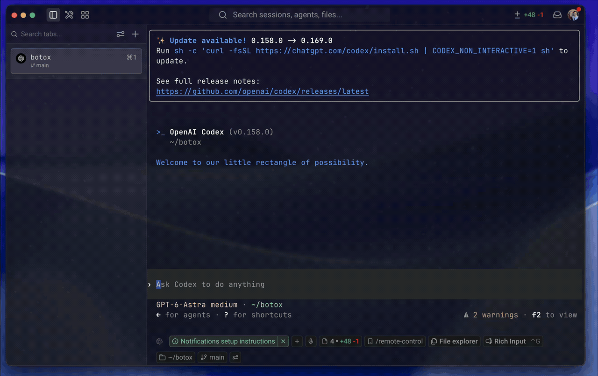

# sshawty

**Screenshots for Codex and Claude Code sessions over SSH.**

Image paste that works locally can fail in an SSH session: the screenshot is on your computer, while the coding agent is running on another machine. sshawty gets the image onto that remote machine and copies its absolute path to your clipboard.

1. Take a screenshot on your computer.
2. Drop it onto a saved SSH host in sshawty. The app uploads it with SCP and copies the remote path.
3. Paste that path into your remote Codex or Claude chat. The agent can read the image from its own filesystem.

No manual SCP commands or retyping paths. Hosts, destination folders, and upload history are saved for next time. Built in Rust with a small native interface.



*The demo shows a failed image paste over SSH, uploading the screenshot through sshawty, and adding it to the same remote Codex chat.* [Download the sharper MP4](https://github.com/lkuich/sshawty/raw/refs/heads/main/docs/demo.mp4).

## Download

Download the archive for your platform from [GitHub Releases](https://github.com/lkuich/sshawty/releases/latest):

| Platform | Download |
| --- | --- |
| macOS, Apple Silicon | `sshawty-macos-arm64.zip` |
| Windows, x64 | `sshawty-windows-x86_64.zip` |
| Linux, x64 | `sshawty-linux-x86_64.tar.gz` |

Extract the archive and launch the app. Linux builds target Ubuntu 24.04 or compatible systems and require X11/XWayland. macOS downloads are Apple Silicon only, require macOS 12+, and are ad-hoc signed, not notarized. Windows builds are unsigned. All platforms need OpenSSH 9+ installed. Checksums are included in `SHA256SUMS.txt` with each release.

To update, quit sshawty and replace the app in Applications on macOS, or the executable on Windows/Linux. Hosts and history stay in the separate app-data directory. There is no automatic updater.

For development builds, open a successful [Actions run](https://github.com/lkuich/sshawty/actions/workflows/check.yml) and download its platform artifact (GitHub sign-in required).

## Run from source

On macOS, open `dist/sshawty.app`, or build it with:

```sh
./scripts/package-macos.sh
open dist/sshawty.app
```

On Windows and Linux:

```sh
cargo run --release --locked
```

Rust 1.95 is pinned in `rust-toolchain.toml`. GitHub Actions builds macOS, Windows, and Linux artifacts. The macOS bundle is locally ad-hoc signed, not notarized for public distribution.

System requirements: OpenSSH **9 or newer**, with both `ssh` and `scp` on PATH; OpenGL-capable desktop. Linux requires **X11 or XWayland** (`DISPLAY` must be set); native Wayland drag/drop is not supported by the pinned winit backend. The UI deliberately uses X11 there, while clipboard support includes Wayland data-control where available.

## Use

1. Verify `ssh your-host` works in Terminal. Accept the host fingerprint only after verifying it, and load encrypted keys into your SSH agent.
2. Use **+** to add a host, or its pencil icon to edit it. Enter a display name, an SSH alias or `user@host`, and a destination such as `~/screenshots`. Set ports, identity files, and jump hosts in your normal SSH config; bracket IPv6 addresses. Validation errors appear inside the dialog. Save with **Add host** or **Save changes**; Cancel, the close icon, or Escape discards the draft.
3. Click a host card in the grid to select it and show only its recent uploads. Click it again to clear the selection and show all uploads. The selected host is also the target for clipboard paste.
4. Drop PNG, JPEG, or WebP files directly onto a host card. On macOS, floating screenshot previews are supported. For clipboard screenshots, select a host and use the clipboard icon or Cmd+V / Ctrl+V outside a text field.
5. Use the expand icon or double-click a card to focus one host. Double-click again, use **All hosts**, or press Escape to return to the grid. Returning keeps that host selected; click its card once more to show all upload history.
6. Successful uploads automatically copy absolute remote paths, one path per line for a batch. To copy again, click a path or its copy icon in **Recent uploads**. Copy success shows a toast. Host cards have no separate copy button. Icon buttons have tooltips and accessibility labels.

Uploads run sequentially in the background. Each uses a unique remote filename and a private local snapshot. A temporary remote file is published without overwriting an existing destination. Existing source files are never modified. Destinations must be Linux/macOS SSH servers with a POSIX-compatible login shell, SFTP, and hard-link support on the destination filesystem.

Limits: 50 MiB per file, the image decoder's memory limit, 256 MiB for clipboard pixel data, five minutes per SSH command. Cancel stops active child processes and skips queued work. Cleanup is best effort after network loss; a hidden `.sshawty-*.part` file may remain remotely. A disconnect during final publication can leave a complete file without a success record; retry uses a new name.

History and 160×100-or-smaller thumbnails persist until you clear them. A row’s trash icon removes that history entry; the trash icon beside **Recent uploads** clears only the currently visible entries, respecting the selected-host filter. Removing a host keeps its upload history and clears selection if that host was selected. None of these actions deletes remote screenshots. No full-resolution local image copies are retained after a batch finishes.

## Local data

- macOS: `~/Library/Application Support/sshawty/`
- Linux: `$XDG_DATA_HOME/sshawty/` (normally `~/.local/share/sshawty/`)
- Windows: `%LOCALAPPDATA%\sshawty\data\`

`state.json` stores versioned host settings, selection, and completed uploads; `thumbnails/` holds previews. Writes replace the JSON atomically. An unreadable/unsupported state file is preserved and disables saving for that session. Move it aside or repair it before restarting. Thumbnails contain screenshot content, so treat the app-data directory accordingly.

## App icon

The app uses the same mint upload mark in its interface, macOS bundle, Windows executable, and window/taskbar icon. The editable source is `assets/icon.svg`; regenerate the checked-in PNG, ICO, and ICNS files with `scripts/generate-icons.sh` on macOS with ImageMagick installed. Normal builds use the checked-in files.

Windows builds need the Windows SDK resource compiler (`rc.exe`) with MSVC, or MinGW-w64 resource tools when cross-compiling. GitHub runners include the required Windows SDK.

## Checks

```sh
cargo fmt --check
cargo clippy --locked --all-targets -- -D warnings
cargo test --locked
```

Tests cover host selection and history filtering, focus toggles, validation, persistence corruption, shell quoting, unique upload paths, byte preservation, permissions, cancellation, errors, and partial cleanup. On macOS a native AppKit harness also exercises saved-file drops and simulated screenshot promises with both immediate and deferred delivery. The controlled-command test executes actual POSIX remote scripts against an isolated temporary directory, using fake SSH/SCP launchers.

An optional real OpenSSH test uploads a generated 8×8 PNG to a unique `/tmp/sshawty-test-*` directory, compares the remote bytes, and removes the test file and directory:

```sh
SSHAWTY_TEST_HOST=user@host cargo test real_openssh_upload -- --ignored
```

CI checks formatting, Clippy, tests, and release builds on all supported platforms, including native AppKit file and screenshot-promise drop tests on macOS. Real SSH transfers and floating screenshot previews have also been checked locally. Recent dialog and selection changes still need manual visual acceptance testing; Windows and Linux clipboard/drop behavior also need manual GUI testing.

No password storage, remote folder browser, tray/global shortcuts, automatic remote cleanup, updater, or telemetry.

## Publishing a release

Every main-branch push and pull request builds and tests three platform archives: macOS Apple Silicon, Windows x64, and Linux x64. Intel macOS builds are no longer produced. To publish a release, update the version in `Cargo.toml` (and `Cargo.lock`), commit it, then push a matching tag:

```sh
version=$(cargo metadata --no-deps --format-version 1 | python3 -c 'import json,sys; print(json.load(sys.stdin)["packages"][0]["version"])')
git tag "v$version"
git push origin "v$version"
```

The workflow checks that the tag matches the package version, waits for all platform checks and builds, then publishes the archives and SHA-256 checksums to GitHub Releases. The repository's built-in `GITHUB_TOKEN` is sufficient; no additional release secret is needed.
